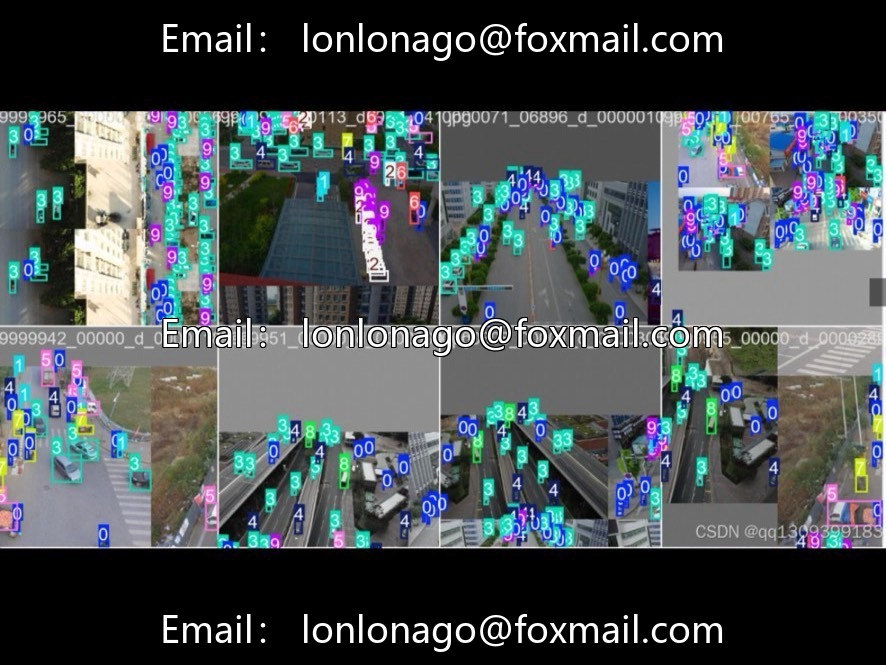
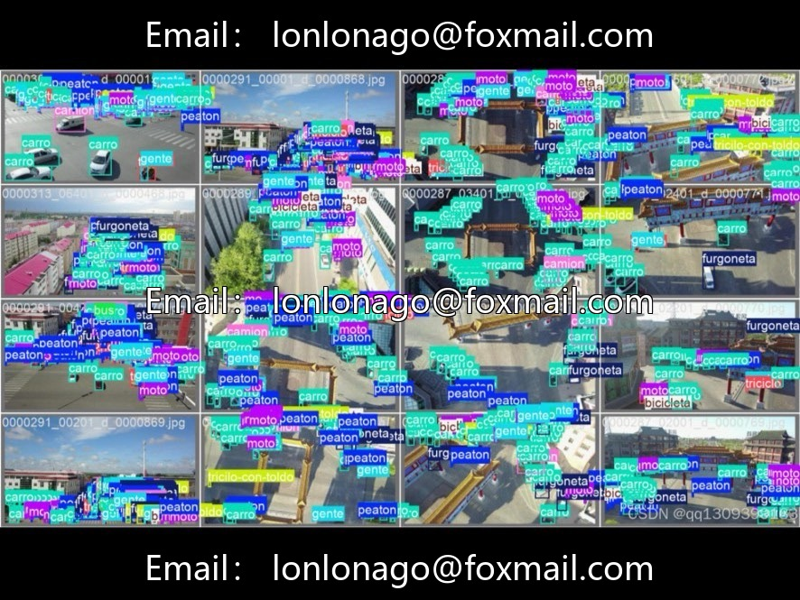
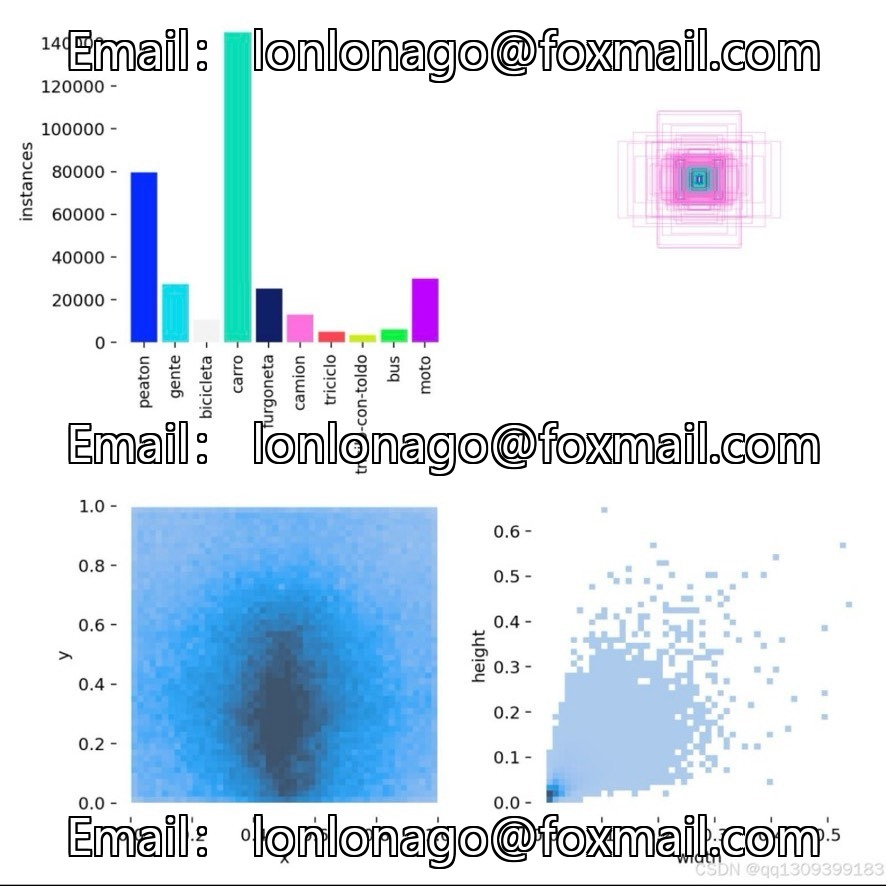

# Summary of UAV Image Recognition Project Dataset Information Based on VisDrone

## Body

Summary of UAV Image Recognition Project Dataset Information, based on the VisDrone dataset, combined with format conversion, annotation cleaning, and data expansion, to adapt to multi-category target detection tasks such as pedestrians and vehicles from a UAV perspective.

Dataset Content
- Core Data Source: VisDrone, 14985 images in COCO format
- Format Conversion: Bulk conversion from COCO to YOLO, supporting YOLOv8/v11
- Annotated Cleaning: Self-developed tool fixes 7.2% incorrectly labeled data, addressing aerial photography occlusion issues
- Data Augmentation: Blender generates 2000 extreme weather synthetic samples, including rain, fog, strong light, and other complex scenes
- Data Augmentation: Mosaic9, MixUp, HSV perturbation combination

- Detection target categories and mAP@0.5: Pedestrians, crowds, bicycles, cars, vans, trucks, tricycles, roofed tricycles, buses, motorcycles, average mAP@0.5 across all categories: 0.349
- Coverage scenarios: daytime, nighttime, regular weather, extreme weather, urban security, intelligent transportation, smart logistics, etc., for drone landing scenarios
- Hardware and model compatibility: desktop (RTX3090/4090), edge (Jetson Xavier NX), YOLOv8/v11 full series

Virtual materials, once sold, are non-refundable.
Interested friends, click "I want" to proceed.

## Images

## Payment

Here is a pay link on Stripe ( https://buy.stripe.com/3cs8yP7sY87d0vu9AB ). Please contact me lonlonago@foxmail.com after funding $89, and I will send you a complete data files , thank you!

